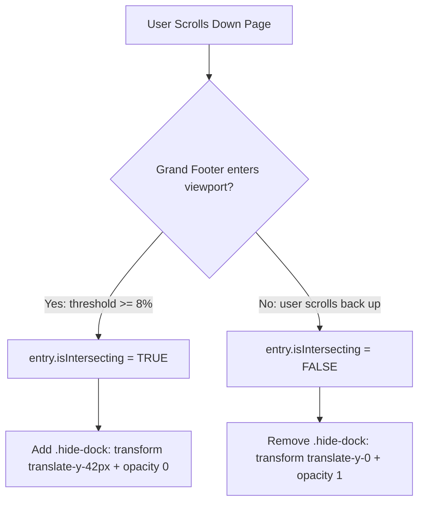

# Studio Index — Master Guide: Floating UI, IntersectionObserver & Modern Interactions

This document is your complete, beginner-friendly reference for everything implemented in the Studio Index storefront, modeled after `starter/omor.html`. Whenever you need to build floating bars, sliding docks, frosted glass headers, or responsive floating buttons in future projects, reference this guide!

---

## Table of Contents
1. [The Mystery: How Does the Floating Footer Know When to Slide Away?](#1-the-mystery-how-does-the-floating-footer-know-when-to-slide-away)
2. [How the Slide Away & Slide Back Animation Works](#2-how-the-slide-away--slide-back-animation-works)
3. [The Ultrawide Screen Fix: Relative Floating Elements](#3-the-ultrawide-screen-fix-relative-floating-elements)
4. [Fixed Header with Frosted Glass Blur (Glassmorphism)](#4-fixed-header-with-frosted-glass-blur-glassmorphism)
5. [Hover Micro-Interactions & Luxury Amber Colors](#5-hover-micro-interactions--luxury-amber-colors)
6. [How to Program Smooth Scrolling to Any Element Yourself (Without AI)](#6-how-to-program-smooth-scrolling-to-any-element-yourself-without-ai)
7. [Quick Cheat Sheet of Files & Implementations](#7-quick-cheat-sheet-of-files--implementations)

---

## 1. The Mystery: How Does the Floating Footer Know When to Slide Away?

### The Problem
When users are browsing products, they see the minimal pill dock:
> `Powered by Studio Index | Launch Your Store →`

As they scroll down to the bottom of the page, the giant **Grand Footer** appears. If the floating dock stays on screen, it covers the footer buttons, creates clutter, and looks amateurish.

In `omor.html`, the dock magically **slides down and disappears** the moment the footer enters the screen, and **slides right back up** when the user scrolls back up.

### How Does It Know? The `IntersectionObserver` API

In older web development, developers used `window.addEventListener('scroll', ...)` and calculated pixel heights like:
```javascript
// ❌ THE OLD, BAD WAY (Laggy, causes stuttering on scroll)
window.addEventListener('scroll', () => {
    const footerTop = footer.getBoundingClientRect().top;
    if (footerTop < window.innerHeight) { ... }
});
```
This runs calculations on every single scroll tick (dozens of times per second), draining battery and causing jank on mobile phones.

Modern browsers have a high-performance, asynchronous API called **`IntersectionObserver`**:
* Instead of running on every scroll pixel, the browser's graphics engine watches the target element and notifies your code **only when the element actually enters or leaves the visible screen**.



### The Anatomy of an Intersection Observer

```javascript
const observer = new IntersectionObserver(
    (entries) => {
        entries.forEach((entry) => {
            // entry.isIntersecting is a boolean:
            // true  = the target is visible on screen!
            // false = the target has left the screen!
            console.log("Is target visible?", entry.isIntersecting);
        });
    },
    {
        // threshold: 0.08 means: trigger when 8% of the target is inside the viewport
        threshold: 0.08
    }
);

// Tell the observer which DOM element to watch:
observer.observe(document.getElementById('grand-anon-footer'));
```

### The React Implementation in `FloatingFooter.tsx`

```tsx
import { useState, useEffect } from "react";

export function FloatingFooter() {
    const [isDockHidden, setIsDockHidden] = useState(false);

    useEffect(() => {
        // 1. Find the target element (the footer at the bottom)
        const grandFooter = document.getElementById("grand-anon-footer");
        if (!grandFooter || !("IntersectionObserver" in window)) return;

        // 2. Create the observer
        const observer = new IntersectionObserver(
            (entries) => {
                entries.forEach((entry) => {
                    // When the footer enters the screen, isIntersecting is true -> hide dock!
                    // When the footer leaves the screen, isIntersecting is false -> show dock!
                    setIsDockHidden(entry.isIntersecting);
                });
            },
            { threshold: 0.08 }
        );

        // 3. Start observing
        observer.observe(grandFooter);

        // 4. Always clean up when component unmounts
        return () => observer.disconnect();
    }, []);

    // ... render JSX ...
}
```

---

## 2. How the Slide Away & Slide Back Animation Works

Now that React knows whether the footer is visible (`isDockHidden = true` or `false`), how do we animate the sliding motion?

### The CSS `transform` & `transition` Secret

Instead of changing CSS `bottom` (which causes browser reflow and feels jittery), we use GPU-accelerated **`transform: translateY(...)`** and **`opacity`**:

```tsx
<div
    style={{
        // When hidden: slide down 42px into the bottom bezel and fade out
        // When visible: sit in normal position and stay fully visible
        transform: isDockHidden ? "translate(-50%, 42px)" : "translate(-50%, 0)",
        opacity: isDockHidden ? 0 : 1,

        // Disable clicks while hidden so users can't accidentally click an invisible button
        pointerEvents: isDockHidden ? "none" : "auto",

        // Smooth cubic-bezier timing curve from omor.html:
        transition: "opacity 0.4s ease, transform 0.4s cubic-bezier(0.16, 1, 0.3, 1)",
    }}
>
```

#### Why `cubic-bezier(0.16, 1, 0.3, 1)`?
Standard `ease-in` or `linear` transitions feel robotic. `cubic-bezier(0.16, 1, 0.3, 1)` provides a springy, deceleration curve that feels like native iOS / luxury software.

---

## 3. The Ultrawide Screen Fix: Relative Floating Elements

### The Problem
If you use standard `position: fixed; right: 24px; bottom: 64px;`:
* On an iPhone (390px wide): Looks great, sits on the bottom right.
* On a 27" iMac or 4K Ultrawide monitor (2560px or 3840px wide):
  The storefront content is centered in the middle of the screen (e.g. 1180px wide), but the floating bag is pushed **1000px away to the far right bezel of the monitor**! The user has to look completely away from the products just to see their cart.

```
ULTRAWIDE MONITOR (3440px wide):
+--------------------------------------------------------------------------------------------------+
|                                                                                                  |
|                       [    Centered Storefront Content (1180px)    ]                             |
|                       [   Sellers Info | Product Cards | Reviews   ]                             |
|                                                                                                  |
|                                                                             [Floating Bag ❌]    |
|                                                                          (Stuck on monitor edge) |
+--------------------------------------------------------------------------------------------------+
```

### The Solution: The "Centered Ghost Frame" Pattern
We want the floating bag to:
1. Float along as the user scrolls (needs `position: fixed`).
2. Stay anchored to the **same max width** as the storefront (needs `max-w-[1180px] mx-auto`).
3. NOT block clicks on any products behind it (needs `pointer-events-none`).

Here is how we set it up:

#### Step 1: The Centered Ghost Wrapper in `Storefront.tsx`
```tsx
{/* Main centered container */}
<div className="w-[95%] max-w-[1180px] mx-auto flex flex-col items-center pt-16 relative">
  <SellersInfo username={username} />
  <Products ProductsArray={ProductsArray} />

  {/* Ghost Overlay: Fixed to viewport bottom, but centered and capped at 1180px width */}
  <div className="fixed bottom-0 left-1/2 -translate-x-1/2 w-[95%] max-w-[1180px] pointer-events-none z-45 h-0">
    <FloatingBag />
  </div>

  <FloatingFooter />
</div>
```

#### Step 2: In `FloatingBag.tsx`
```tsx
<button
  type="button"
  // absolute relative to the ghost frame!
  // pointer-events-auto restores clickability!
  className="absolute bottom-16 right-2 sm:right-6 pointer-events-auto flex items-center ..."
>
  ...
</button>
```

#### How it behaves now:
* On mobile: `w-[95%]` spans the screen, so `right-2` sits at the bottom right of the phone.
* On Ultrawide (2560px+): `max-w-[1180px]` locks the width. The bag stays right at the right border of your product grid, perfectly integrated into the luxury layout!
* `pointer-events-none` on the frame ensures all clicks pass straight through to products, while `pointer-events-auto` makes the bag button 100% clickable.

---

## 4. Fixed Header with Frosted Glass Blur (Glassmorphism)

### The Requirements:
1. Header stays pinned at `top: 0` while scrolling.
2. Background is semi-transparent with a frosted blur so text scrolling underneath looks blurred.
3. Content below doesn't get covered on page load.

### Implementation:

#### In `header.tsx`:
```tsx
<header
    className="flex justify-center text-xs gap-2.5 py-4 items-center w-full fixed top-0 left-0 right-0 z-40"
    style={{
        color: "#a3a3a3",
        borderBottom: "1px solid rgba(38, 38, 38, 0.85)",
        // 1. Semi-transparent dark background (CRITICAL: 100% solid color will NOT blur anything behind it!)
        background: "rgba(10, 10, 10, 0.82)",
        // 2. Frosted blur effect (both standard and Safari/WebKit prefixes)
        backdropFilter: "blur(12px)",
        WebkitBackdropFilter: "blur(12px)",
    }}
>
    <DiamondsFourIcon weight="fill" color="#a3a3a3" size={20} />
    <h4>STUDIO INDEX</h4>
</header>
```

#### The "Content Jump" Gotcha:
When an element is set to `position: fixed`, it is pulled out of the document flow. If your first section doesn't have top padding, the top of your `SellersInfo` card will hide underneath the header!
* **The Fix**: In `Storefront.tsx`, add `pt-16` (64px) to the parent container so everything starts neatly below the header on load.

---

## 5. Hover Micro-Interactions & Luxury Amber Colors

In `starter/omor.html`, the color palette and interaction rules are carefully tuned:

### The Brand Colors
* **Primary Amber**: `#fbbf24` (Tailwind `amber-400`). Used for badges, primary accents, and icon highlights.
* **Button Hover Amber**: `#fde047` (Tailwind `yellow-300` / light warm amber).
* **Glow Shadow**: `rgba(251, 191, 36, 0.35)`.
* **Surface Backgrounds**: `linear-gradient(135deg, #18181c 0%, #0a0a0c 100%)`.

### 1. Sellers Info Bag Button Hover (`SellersInfo.tsx`)
```tsx
<button
    className="font-bold text-[12px] flex-1 px-5 rounded-xl cursor-pointer transition-all duration-200"
    style={{ background: "#fbbf24", color: "#0a0a0a" }}
    onMouseEnter={e => {
        (e.currentTarget as HTMLButtonElement).style.background = "#fde047";
        (e.currentTarget as HTMLButtonElement).style.transform = "translateY(-1px)";
        (e.currentTarget as HTMLButtonElement).style.boxShadow = "0 8px 20px -5px rgba(251, 191, 36, 0.35)";
    }}
    onMouseLeave={e => {
        (e.currentTarget as HTMLButtonElement).style.background = "#fbbf24";
        (e.currentTarget as HTMLButtonElement).style.transform = "translateY(0)";
        (e.currentTarget as HTMLButtonElement).style.boxShadow = "none";
    }}
>
    OPEN BAG
</button>
```

### 2. Floating Bag Pop-Scale Hover (`FloatingBag.tsx`)
Never transition to muddy brown `#78350f`! Instead, maintain the sleek gradient and elevate the button physically:
```tsx
onMouseEnter={e => {
    const el = e.currentTarget as HTMLButtonElement;
    // Elevates 4px and expands by 8%
    el.style.transform = "translateY(-4px) scale(1.08)";
    el.style.boxShadow = "0 20px 42px rgba(0, 0, 0, 0.95), 0 0 28px rgba(251, 191, 36, 0.4)";
}}
onMouseLeave={e => {
    const el = e.currentTarget as HTMLButtonElement;
    el.style.transform = "translateY(0) scale(1)";
    el.style.boxShadow = "0 15px 35px rgba(0, 0, 0, 0.85), 0 0 20px rgba(251, 191, 36, 0.2)";
}}
```

### 3. "Launch Your Store" Inverted Hover (`FloatingFooter.tsx`)
* **Default**: Amber border + transparent background + amber text (`#fbbf24`).
* **Hover**: Solid amber fill (`#fbbf24`) + dark pitch text (`#0a0a0a`) + glowing box-shadow.

---

## 6. How to Program Smooth Scrolling to Any Element Yourself (Without AI)

When a user clicks a button like **"Launch Your Store →"**, you want the browser to glide straight to the exact card:
> *"Have A Lucrative Business In Mind? Claim Your Luxury Link."*

Here is the exact blueprint so you can code this into any website without needing AI.

---

### Method A: The JavaScript `scrollIntoView` API (Most Powerful)

This is what we used in `FloatingFooter.tsx`:

#### Step 1: Give your target card an `id` and `scroll-mt`
In your footer or destination component:
```html
<!-- In Footer.tsx -->
<div id="claim-luxury-link" class="scroll-mt-24 ...">
    <h3>Have A Lucrative Business In Mind? Claim Your Luxury Link.</h3>
    <input id="claim-handle-input" placeholder="your_brand_name" />
</div>
```

#### Step 2: Call `scrollIntoView()` on click
In your button component:
```javascript
const handleButtonClick = () => {
    // 1. Find the target card in the DOM
    const card = document.getElementById("claim-luxury-link");
    
    if (card) {
        // 2. Smoothly glide to it
        card.scrollIntoView({
            behavior: "smooth", // 'smooth' enables animated glide; 'auto' jumps instantly
            block: "start",    // 'center' puts it in the middle of screen! ('start', 'end', or 'nearest')
        });

        // 3. (Optional Pro Trick) Auto-focus the input field so the user can start typing!
        const input = document.getElementById("claim-handle-input");
        if (input) {
            setTimeout(() => input.focus(), 450); // wait 450ms for scroll to finish
        }
    }
};
```

#### Why `scroll-mt-24` (`scroll-margin-top`) is Crucial:
If you have a `fixed` or `sticky` top header, scrolling to `block: "start"` will place the top of your card directly **behind** the header!
Adding `scroll-mt-24` (or `style={{ scrollMarginTop: "96px" }}`) creates an invisible cushion so the element never gets cut off by your navbar.

---

### Method B: The React `useRef` Approach (If Both Are In the Same Component)

If your button and destination card live in the same component, React developers often use `useRef`:

```tsx
import { useRef } from "react";

function Page() {
    const claimSectionRef = useRef<HTMLDivElement>(null);

    const scrollToSection = () => {
        claimSectionRef.current?.scrollIntoView({
            behavior: "smooth",
            block: "center",
        });
    };

    return (
        <div>
            <button onClick={scrollToSection}>Launch Store</button>

            {/* Down at the bottom */}
            <div ref={claimSectionRef}>
                <h2>Claim Your Link</h2>
            </div>
        </div>
    );
}
```

*Note: When your button is in a floating component (`FloatingFooter.tsx`) and the target is inside another component (`Footer.tsx`), using `document.getElementById(...)` (Method A) is much simpler and avoids passing refs through multiple parent components.*

---

### Method C: Pure HTML & CSS (No JavaScript Needed!)

If you just want a standard anchor link:
1. In your global CSS (`index.css`):
   ```css
   html {
       scroll-behavior: smooth;
   }
   ```
2. In your HTML/JSX:
   ```html
   <!-- The link -->
   <a href="#claim-luxury-link">Launch Your Store →</a>

   <!-- The destination -->
   <div id="claim-luxury-link">
       ...
   </div>
   ```

---

## 7. Quick Cheat Sheet of Files & Implementations

| Component | File Path | Key Techniques Used |
| :--- | :--- | :--- |
| **Fixed Header** | `src/components/header.tsx` | `fixed top-0`, `backdrop-filter: blur(12px)`, `rgba(10,10,10,0.82)` |
| **Sellers Bag Console** | `src/components/SellersInfo.tsx` | `#fde047` hover background, `translateY(-1px)`, amber glow shadow |
| **Floating Bag** | `src/components/FloatingBag.tsx` | `scale(1.08) translateY(-4px)` lift, metallic dark gradient |
| **Floating Dock Pill** | `src/components/FloatingFooter.tsx` | `IntersectionObserver`, `translateY(42px)` slide away, `#fbbf24` button hover |
| **Grand Footer Target** | `src/components/footer/Footer.tsx` | Target `id="grand-anon-footer"` observed by the dock |
| **Claim Card Target** | `src/components/footer/Footer.tsx` | `id="claim-luxury-link"`, `scroll-mt-24`, input `id="claim-handle-input"` |
| **Main Layout Wrapper** | `src/pages/Storefront.tsx` | `max-w-[1180px] mx-auto`, `pt-16` offset, pinned floating UI ghost container |

---
*Created for Studio Index. Save this file for quick review anytime!*
